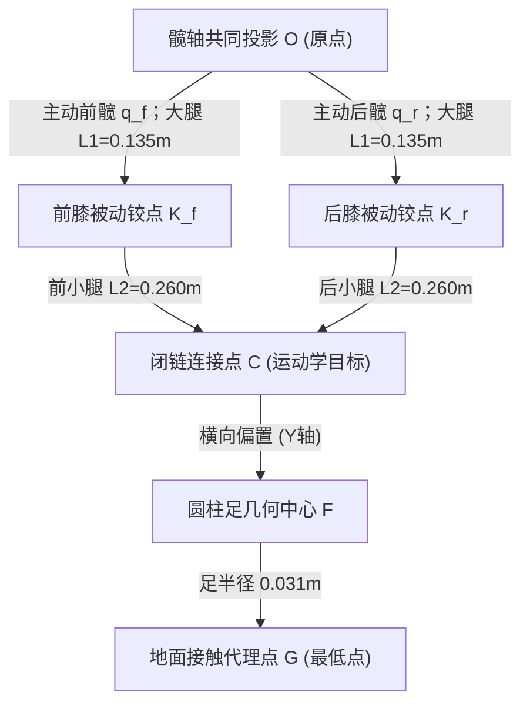

# 四足机器人腿部运动学与控制指南

本指南详细整理了机器人腿部的机构构型、坐标系约定、正逆运动学（FK/IK）、雅可比矩阵以及仿真/控制接口的对接方法。全部几何与控制参数均与模型文件 [`robot.xml`](../simulation/generated_robot-mjcf_v2/robot.xml) 及参数集 [`robot_parameters.json`](robot_parameters.json) 严格对齐。

---

## 1. 核心速查与机构概览

### 1.1 核心尺寸卡片

| 参数项 | 数值 | 含义说明 |
| :--- | :--- | :--- |
| **机构类型** | **平面五连杆闭链** | 双主动髋关节驱动，前后支链在小腿处通过铰链闭合 |
| **自由度配置** | 2 自由度 / 腿 | 平面 2 自由度驱动，无髋外展/内收关节（横向位置由安装固定） |
| **大腿长 $L_1$** | **0.135 m** | 髋关节旋转轴 $\to$ 膝部被动铰点在运动平面内的投影距离 |
| **小腿长 $L_2$** | **0.260 m** | 膝部被动铰点 $\to$ 足端闭合点在运动平面内的投影距离 |
| **髋轴平面间距** | **0 m** | 前后两台髋电机轴向虽有安装错位，但在**腿部运动平面内投影完全同心** |
| **圆柱足半径 $r_{foot}$** | **0.031 m** | 26 边形圆柱足几何半径（轴向宽度 0.050 m） |
| **整机质量分布** | 整机 9.36 kg | 基座 7.716 kg（已包含 8 台电机），单腿 0.411 kg |

> [!TIP]
> **设计特点**：由于前后髋电机在运动平面内投影完全同心（$d_{hip,plane} = 0$），本机器人不能按常规的串联腿（髋-膝串联）来写逆解，也不要套用带间距的通用五连杆公式，其运动学等效为典型的**同心圆弧交点机构**。

---

### 1.2 运动拓扑与关键参考点

每条腿由两条支链构成，运动学中定义了三个不同层次的“足端”位置：



* **闭合点 $C$**：模型中前后小腿的几何铰接点（对应 XML 中的 `closure_*_site`），这是**五连杆运动学方程直接计算的目标点**。
* **足心点 $F$**：圆柱足网格的几何中心。它在腿部运动平面内的投影与 $C$ 基本重合，但在机体横向（$Y$ 轴）上有固定的结构安装偏置。
* **足底触地点 $G$**：理想圆柱足接触水平地面时的理论最低点，高度比足心 $F$ 低一个足半径 $r_{foot} = 0.031\,\text{m}$。

---

## 2. 坐标系与符号定义

### 2.1 机体坐标系 $B$
* **原点**：`base_link` 几何中心。
* **轴向**：
  * $+X_B$：指向机器人前方（FR / FL 方向）；
  * $+Y_B$：指向机器人左侧（FL / RL 方向）；
  * $+Z_B$：在机体水平时垂直向上。

---

### 2.2 腿部局部平面坐标系 $L$

为了让四条腿能够共用同一套平面正逆运动学公式，我们为每条腿建立局部坐标系 $L=(u, v, w)$：
* $+u = +X_B$（水平向前）
* $+v = -Z_B$（**垂直向下**，向下为正方便足端深度计算）
* $+w = +Y_B$（横向向左）
* **局部原点**：该腿髋轴在足心运动平面内的投影点 $o_B = (h_x, y_F, 0)^T$。

四条腿的几何安装位置与方向系数定义如下：

| 腿代号 | 腿名称 | 髋轴纵向位置 $h_x$ | 足心横向偏置 $y_F$ | 闭合点横向偏置 $y_C$ | 转向系数 $\sigma$ | 装配分支 $\eta$ |
| :---: | :---: | :---: | :---: | :---: | :---: | :---: |
| **RR** | 右后 (Rear-Right) | -0.23525 m | -0.13755 m | -0.16645 m | **-1** | -1 |
| **FR** | 右前 (Front-Right) | +0.23525 m | -0.13755 m | -0.17095 m | **-1** | +1 |
| **FL** | 左前 (Front-Left) | +0.23525 m | +0.13755 m | +0.16645 m | **+1** | +1 |
| **RL** | 左后 (Rear-Left) | -0.23525 m | +0.13755 m | +0.17095 m | **+1** | -1 |

> [!NOTE]
> * 前后髋安装间距：$2 \times 0.23525 = 0.4705\,\text{m}$；左右足心间距：$2 \times 0.13755 = 0.2751\,\text{m}$。
> * **转向系数 $\sigma$**：由于左右腿电机的轴向朝外安装，左腿关节正转使连杆下摆角增加（$\sigma=+1$），右腿关节正转使连杆下摆角减小（$\sigma=-1$）。

---

### 2.3 CAD 初始装配偏置角

模型导入时，各连杆在大腿和小腿局部系中已存在初始装配夹角。各支链的初始方向角定义如下：

$$\alpha_i = \operatorname{atan2}(\sigma a_{i,y},\, a_{i,x}), \qquad \beta_i = \operatorname{atan2}(\sigma b_{i,y},\, b_{i,x}) \quad (i \in \{f, r\})$$

| 支链 | $\alpha$ (大腿初角, rad) | $\beta$ (小腿初角, rad) | $\beta - \alpha$ (装配偏置, rad) |
| :---: | :---: | :---: | :---: |
| **RR 前** | 0.512094 | 2.062898 | +1.550805 |
| **RR 后** | 2.664460 | 1.113655 | -1.550805 |
| **FR 前** | 2.063526 | 0.911566 | -1.151961 |
| **FR 后** | 0.506173 | 1.658134 | +1.151961 |
| **FL 前** | 2.035392 | 1.032434 | -1.002958 |
| **FL 后** | 0.688877 | 1.691834 | +1.002958 |
| **RL 前** | 0.676324 | 2.061290 | +1.384966 |
| **RL 后** | 2.574718 | 1.189752 | -1.384966 |

连杆在局部平面内的绝对姿态角为：
* **大腿绝对角**：$\theta_i = \alpha_i + \sigma q_i$
* **小腿绝对角**：$\phi_i = \beta_i + \sigma(q_i + \psi_i)$

其中 $q_i$ 为主动髋关节角，$\psi_i$ 为膝部被动关节角。

---

## 3. 正运动学 (FK)：由关节角推导足端位置

已知前、后主动髋关节角 $q = (q_f, q_r)^T$，求解足端闭合点在局部平面内的坐标 $c = (u, v)^T$。

```
       O (0, 0)
      / \
 L1  /   \ L1
    v     v
   Kf --- Kr  (间距 D)
    \     /
 L2  \   / L2
      v v
       C (u, v)
```

### 求解步骤：
1. **计算膝关节铰点坐标**：
   $$K_f = \begin{bmatrix} L_1 \cos\theta_f \\ L_1 \sin\theta_f \end{bmatrix}, \qquad K_r = \begin{bmatrix} L_1 \cos\theta_r \\ L_1 \sin\theta_r \end{bmatrix}$$

2. **计算两膝点间距与基向量**：
   $$d = K_r - K_f, \quad D = \|d\|, \quad t = \frac{d}{D}, \quad t_\perp = \begin{bmatrix} -t_y \\ t_x \end{bmatrix}$$

3. **双圆相交求闭合点 $C$**：
   由于前后小腿长度均为 $L_2 = 0.260\,\text{m}$，交点位于中垂线上：
   $$c = \frac{K_f + K_r}{2} + \eta \sqrt{L_2^2 - \frac{D^2}{4}} \cdot t_\perp$$

> [!IMPORTANT]
> **分支选择 $\eta$**：
> * 前腿（FR / FL）：默认构型取 $\eta = +1$；
> * 后腿（RR / RL）：默认构型取 $\eta = -1$；
> * 连续控制中应保持前一时刻的装配分支，避免圆交点突变跳跃。

---

## 4. 逆运动学 (IK)：由足端位置求解关节角

已知局部平面内的期望闭合点目标 $c = (u, v)^T$，求解主动角 $(q_f, q_r)$ 及对应的被动角 $(\psi_f, \psi_r)$。

### 4.1 几何求解推导
针对前、后每个独立支链 $i \in \{f, r\}$，问题转化为标准的二连杆逆解：

1. **计算目标距离与余弦值**：
   $$r^2 = u^2 + v^2, \qquad k_i = \frac{r^2 - L_1^2 - L_2^2}{2 L_1 L_2}$$
   *必须校验工作空间有效性：$|k_i| \le 1$。*

2. **计算膝部弯曲角 $\delta_i$**：
   $$\delta_i = \varepsilon_i \arccos(k_i)$$
   *分支符号 $\varepsilon_i$：RR/RL 前支链取正、后支链取负；FR/FL 前支链取负、后支链取正。*

3. **解算主动角与被动角**：
   $$\theta_i = \operatorname{atan2}(v, u) - \operatorname{atan2}\left(L_2 \sin\delta_i,\; L_1 + L_2 \cos\delta_i\right)$$
   $$q_i = \operatorname{wrap}\big[\sigma (\theta_i - \alpha_i)\big]$$
   $$\psi_i = \operatorname{wrap}\big[\sigma (\delta_i - (\beta_i - \alpha_i))\big]$$
   其中 $\operatorname{wrap}(\phi) = \operatorname{atan2}(\sin\phi, \cos\phi)$ 将角度归一化至 $[-\pi, \pi]$。

### 4.2 径向工作空间限制
仅由杆长限制给出的几何可达范围为：
$$|L_2 - L_1| \le r \le L_1 + L_2 \implies 0.125\,\text{m} \le r \le 0.395\,\text{m}$$

---

## 5. 足端参考点之间的换算

输入控制目标时，需在足底接触点、足心与闭合点之间做换算：

### 5.1 机体系下的位置换算（水平状态）

给定平面解 $(u, v)$，在机体系下的对应点为：
* **闭合点**：$p_C^B = [h_x + u, \; y_C, \; -v]^T$
* **足心**：$p_F^B = [h_x + u, \; y_F, \; -v]^T$
* **足底触地点**：$p_G^B = [h_x + u, \; y_F, \; -v - r_{foot}]^T \quad (r_{foot} = 0.031\,\text{m})$

**控制换算规则**：
* 若上层规划给出**足底目标** $(x_G, y_G, z_G)$：检查 $y_G \approx y_F$，将高度抬升足半径，得到平面输入 $(u, v) = (x_G - h_x, \; -z_G - 0.031)$，再送入闭合点 IK 求解。
* 若直接指定**足心目标** $(x_F, y_F, z_F)$：输入 $(u, v) = (x_F - h_x, \; -z_F)$。

### 5.2 机体倾斜与世界坐标系转换

当机器人存在姿态倾角时，先将世界系目标转换至机体系：
$$p^B = R_{WB}^T (p^W - p_{base}^W)$$
> [!TIP]
> MuJoCo 中 `base_link` 的旋转矩阵 `xmat` 按**行优先（Row-Major）**存储，在 Eigen 中使用 `Eigen::Map<const Matrix3d>` 时务必指定 `RowMajor`。

---

## 6. 雅可比矩阵：速度与力映射

在机体固定的前提下，足端平面速度与主动关节速度满足 $\dot{c} = J \dot{q}$，列顺序固定为 `[前髋, 后髋]`。

### 6.1 雅可比计算公式
对前、后两支链，定义小腿单位方向向量 $l_i = \frac{c - K_i}{L_2}$，有约束关系：
$$A \dot{c} = B \dot{q}$$
其中：
$$A = \begin{bmatrix} l_f^T \\ l_r^T \end{bmatrix}_{2 \times 2}, \qquad B = \begin{bmatrix} \sigma L_1 \sin(\phi_f - \theta_f) & 0 \\ 0 & \sigma L_1 \sin(\phi_r - \theta_r) \end{bmatrix}_{2 \times 2}$$

在机构非奇异（$\det A \neq 0$）时，雅可比为：
$$J = A^{-1} B \quad (\text{代码中直接求解线性方程 } A \cdot J = B)$$

### 6.2 参考数值（用于算法自检）
在 CAD 默认姿态（`home` 姿态）下，各腿的雅可比矩阵 $J$（行代表 $u, v$，列代表 $q_f, q_r$）理论值如下：

| 腿代号 | $J_{11}\ (u / q_f)$ | $J_{12}\ (u / q_r)$ | $J_{21}\ (v / q_f)$ | $J_{22}\ (v / q_r)$ |
| :---: | :---: | :---: | :---: | :---: |
| **RR** | +0.148976 | +0.146323 | -0.073280 | +0.078443 |
| **FR** | +0.180911 | +0.143551 | +0.015841 | -0.111234 |
| **FL** | -0.184416 | -0.159497 | -0.022431 | +0.095253 |
| **RL** | -0.160926 | -0.152921 | +0.064471 | -0.081663 |

### 6.3 足端力与电机力矩映射
足端对环境施加的平面力 $F = (F_x, -F_z)^T$ 与所需关节力矩 $\tau = (\tau_f, \tau_r)^T$ 满足虚功原理：
$$\tau_q = J^T F$$
若定义 $F_{ext}$ 为地面对足端的支撑反力，则静态平衡所需的前馈电机力矩为 $\tau_q = -J^T F_{ext}$。

---

## 7. 仿真与控制接口对接

### 7.1 电机映射与 MuJoCo 索引表

八台电机在控制器向量 `MotorVector` 中的索引与模型关节的对应关系如下：

| 关节名称 | 控制器索引 (`ctrl`) | 髋 qpos | 髋 qvel | 被动铰链 qpos | 闭合点 Site |
| :--- | :---: | :---: | :---: | :---: | :---: |
| **RR 后髋** | **0** | 7 | 6 | 8 | `closure_001_b_site` |
| **RR 前髋** | **1** | 9 | 8 | 10 | `closure_001_a_site` |
| **FR 前髋** | **2** | 11 | 10 | 12 | `closure_004_a_site` |
| **FR 后髋** | **3** | 13 | 12 | 14 | `closure_004_b_site` |
| **FL 后髋** | **4** | 15 | 14 | 16 | `closure_003_a_site` |
| **FL 前髋** | **5** | 17 | 16 | 18 | `closure_003_b_site` |
| **RL 前髋** | **6** | 19 | 18 | 20 | `closure_005_a_site` |
| **RL 后髋** | **7** | 21 | 20 | 22 | `closure_005_b_site` |

> [!WARNING]
> **支链顺序陷阱**：
> 运动学公式通常按 `[前支链, 后支链]` 计算，但 **RR 腿与 FL 腿在电机向量中是后支链在前**（RR 为 `[1, 0]`，FL 为 `[5, 4]`），赋值时切勿直接假设索引 0 都是前髋！

---

### 7.2 电机减速比与轴侧转换

运动学 IK 输出的角度 $q_i$ 位于**关节输出轴侧**。本项目适配器中转子侧与输出轴侧换算满足：
$$q_{rotor} = 6.33 \cdot q_i, \qquad \dot{q}_{rotor} = 6.33 \cdot \dot{q}_i, \qquad \tau_{rotor} = \frac{\tau_i}{6.33}$$

### 7.3 C++ 控制调用代码示例

```cpp
#include "motor_control.hpp"

// 假设 IK 求解器已解出右后腿 (RR) 的关节输出轴角度
double qFrontRR = -0.14866; // RR 前髋输出轴角度 (rad)
double qRearRR  =  0.18362; // RR 后髋输出轴角度 (rad)

// 1. 构建 8 维输出侧关节角度向量
dog::motor::MotorVector qOutput = dog::motor::MotorVector::Zero();
qOutput[1] = qFrontRR;  // 索引 1 对应 RR 前髋
qOutput[0] = qRearRR;   // 索引 0 对应 RR 后髋

// 2. 将输出轴角度与刚度增益自动转换至转子侧（减速比 6.33 自动折算）
auto command = dog::motor::fromOutput(
    dog::motor::MotorVector::Zero(), // 前馈力矩 tau_ff
    qOutput,                         // 目标位置 q
    dog::motor::MotorVector::Zero(), // 目标速度 dq
    dog::motor::MotorVector::Constant(8.0), // 刚度 Kp (N*m/rad)
    dog::motor::MotorVector::Constant(0.4)  // 阻尼 Kd (N*m*s/rad)
);

// 3. 执行力矩限制与特性包络裁剪，下发给 MuJoCo
controller.apply(data, command);
mj_step(model, data);
```

---

## 8. 水平站立参考姿态 (Level Stance)

CAD 模型的初始零位姿态（`home`）四足高低不平，不适合直接作为站立初值。以下给出经过 MuJoCo 校验的一组**四足等高站立初始几何姿态**：

* **站立目标**：四腿平面闭合点均设为 $c = (0, \; 0.320\,\text{m})^T$（足心位于髋轴正下方 0.320 m）。
* **机体高度**：水平放置于世界高度 $z = 0.351\,\text{m}$（使得足底刚好接触 $z=0$ 地面）。

对应输出轴侧理论关节角如下：

| 腿代号 | 前髋主动角 $q_f$ (rad) | 后髋主动角 $q_r$ (rad) | 前被动膝角 $\psi_f$ (rad) | 后被动膝角 $\psi_r$ (rad) |
| :---: | :---: | :---: | :---: | :---: |
| **RR** | -0.148664 | +0.183625 | +0.218370 | -0.218370 |
| **FR** | -0.417309 | -0.154584 | +0.180474 | -0.180474 |
| **FL** | +0.445443 | -0.028119 | -0.329477 | +0.329477 |
| **RL** | -0.015566 | -0.093883 | -0.052532 | +0.052532 |

---

## 9. 编译与单元测试

本项目提供了完整的 C++17 运动学校验程序 [`tools/check_leg_kinematics.cpp`](../tools/check_leg_kinematics.cpp)，覆盖了 FK/IK 往返自洽性、解析闭合点精度以及雅可比差分检验：

```bash
# 配置与编译
cmake -S tools -B build-motor -DMUJOCO_ROOT=/你的路径/mujoco
cmake --build build-motor --target check_leg_kinematics

# 运行运动学自检
./build-motor/check_leg_kinematics simulation/generated_robot-mjcf_v2/robot.xml

# 或者直接通过 CTest 运行
ctest --test-dir build-motor -R leg_kinematics --output-on-failure
```
