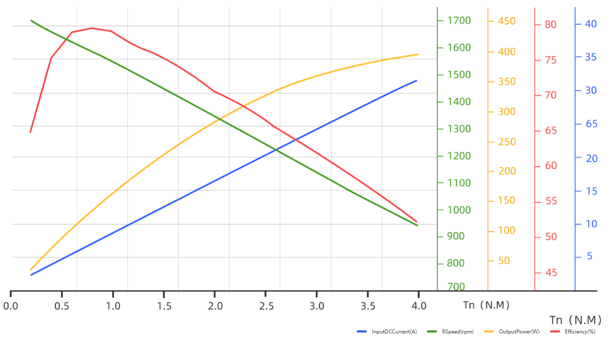

# 四足机器人髋部电机模型与控制指南

本文档介绍机器人 8 台 **宇树 GO-M8010-6** 髋部驱动电机的物理特性、仿真模型配置、转子/输出轴物理量换算、五参数混合控制器以及实机部署注意事项。

---

## 1. 电机参数速查与关节映射

### 1.1 核心技术规格

| 参数项 | 数值 | 轴侧 / 说明 |
| :--- | :--- | :--- |
| **电机型号** | **Unitree GO-M8010-6** | 一体化关节电机（内置驱动器与减速器） |
| **减速比 $N$** | **6.33 : 1** | 内置行星/减速机构 |
| **峰值输出扭矩** | **±23.7 N·m** | 输出轴侧最大允许力矩（转子侧对应 $\pm 3.744\,\text{N}\cdot\text{m}$） |
| **最高输出转速** | **30 rad/s** (~286 rpm) | 24V 标称电压下输出轴最高转速（转子侧对应 $189.9\,\text{rad/s}$） |
| **空载启动摩擦力矩** | **0.15825 N·m** | 输出轴侧标称库仑摩擦（对应转子侧标称指令 $0.025\,\text{N}\cdot\text{m}$） |
| **最大相电流** | **40 A** | 对应折算力矩常数 $K_t \approx 0.63895\,\text{N}\cdot\text{m/A}$（输出侧） |
| **工作供电电压** | **12 ~ 30 V DC** | 推荐标称供电 24 V DC |
| **单机重量** | 约 0.53 kg | 8 台电机共 4.24 kg，**已计入机体 7.716 kg 质量中** |
| **通信接口与协议** | **RS-485 / 4.0 Mbps** | 8N1 串口格式，CRC16-CCITT 校验 |

---

### 1.2 电机在机器人上的拓扑与索引

每条腿配置两台电机，分别驱动前、后髋部支链；8 个小腿关节均为被动铰链。控制器数组及 MuJoCo `ctrl` 索引与各电机的映射如下：

| 数组索引 (`ctrl`) | 所在腿 | 驱动支链 | XML 执行器名 | 关联主动关节名 |
| :---: | :---: | :---: | :--- | :--- |
| **0** | **RR (右后)** | 后支链 | `RR_thigh_rear_motor` | `RR_thigh_rear_joint` |
| **1** | **RR (右后)** | 前支链 | `RR_thigh_front_motor` | `RR_thigh_front_joint` |
| **2** | **FR (右前)** | 前支链 | `FR_thigh_front_motor` | `FR_thigh_front_joint` |
| **3** | **FR (右前)** | 后支链 | `FR_thigh_rear_motor` | `FR_thigh_rear_joint` |
| **4** | **FL (左前)** | 后支链 | `FL_thigh_rear_motor` | `FL_thigh_rear_joint` |
| **5** | **FL (左前)** | 前支链 | `FL_thigh_front_motor` | `FL_thigh_front_joint` |
| **6** | **RL (左后)** | 前支链 | `RL_thigh_front_motor` | `RL_thigh_front_joint` |
| **7** | **RL (左后)** | 后支链 | `RL_thigh_rear_motor` | `RL_thigh_rear_joint` |

> [!WARNING]
> **注意支链顺序**：RR 与 FL 腿在数组中是**后支链在前、前支链在后**；FR 与 RL 腿则是**前支链在前、后支链在后**。下发控制指令时请严格对照上述索引，或通过电机名称查询。

---

## 2. 转子侧 vs 输出轴侧换算规则

在机器人控制中，**算法规划层通常工作在输出轴侧（关节侧），而底层电机驱动芯片及宇树 SDK 通信层工作在转子侧**。务必分清两者的转换关系：

减速比 $N = 6.33$：

```
       [ 上层规划 (输出轴侧) ]
               │
    q_out * N  │  tau_out / N
               ▼
       [ 电机底层 (转子侧) ]
```

### 2.1 运动学与力矩换算
* **位置**：$q_{rotor} = N \cdot q_{output} = 6.33 \cdot q_{output}$
* **速度**：$\dot{q}_{rotor} = N \cdot \dot{q}_{output} = 6.33 \cdot \dot{q}_{output}$
* **力矩**：$\tau_{rotor} = \frac{\tau_{output}}{N} = \frac{\tau_{output}}{6.33}$

### 2.2 PD 控制增益（刚度与阻尼）换算
由于 $\tau = K_p \Delta q$，将转子侧与输出侧代入可得增益必须做**平方折算**：
* **位置刚度增益 $K_p$**：$K_{p,rotor} = \frac{K_{p,output}}{N^2} = \frac{K_{p,output}}{6.33^2} \approx \frac{K_{p,output}}{40.0689}$
* **速度阻尼增益 $K_d$**：$K_{d,rotor} = \frac{K_{d,output}}{N^2} = \frac{K_{d,output}}{6.33^2} \approx \frac{K_{d,output}}{40.0689}$

> [!TIP]
> C++ 控制适配器中提供了辅助函数 `dog::motor::fromOutput(...)`，可自动完成上述全套换算，无需手动计算。

---

## 3. 电机外特性：扭矩-转速曲线与包络

在电机物理特性中，受反电动势和驱动器母线电压限制，**电机无法在最高转速下输出最大扭矩**。



### 3.1 工作特性与降额规律
* **低速区（输出转速 $\le 16.2\,\text{rad/s}$）**：电机可满额输出峰值扭矩 **23.7 N·m**。
* **高速弱磁/降额区（转速 $> 16.2\,\text{rad/s}$）**：可用驱动扭矩随转速上升而线性下降，直到达到空载极限转速 **30 rad/s**（此时可用驱动力矩降为 0）。
* **制动特性**：当电机转速与目标力矩方向相反时（处于发电/制动状态），可用制动力矩不受降额曲线影响，仅受最大力矩 23.7 N·m 限制。

### 3.2 性能读图参考数据 (标称 24V)

| 转子扭矩 (N·m) | 输出扭矩 (N·m) | 转子转速 (rpm) | 输出转速 (rad/s) | 直流母线电流 (A) | 输出机械功率 (W) | 整体效率 (%) |
| :---: | :---: | :---: | :---: | :---: | :---: | :---: |
| 0.20 | 1.27 | 1700 | 28.12 | 2.4 | 37 | 65.4% |
| 0.80 | 5.06 | 1580 | 26.14 | 7.1 | 135 | 79.4% |
| 1.50 | 9.50 | 1440 | 23.82 | 12.6 | 228 | 75.2% |
| 2.00 | 12.66 | 1340 | 22.17 | 16.5 | 282 | 70.5% |
| 2.50 | 15.83 | 1240 | 20.51 | 20.4 | 327 | 66.4% |
| 3.00 | 18.99 | 1130 | 18.69 | 24.3 | 359 | 61.8% |
| 3.50 | 22.16 | 1030 | 17.04 | 28.1 | 380 | 57.1% |
| 3.74 (额定峰值) | **23.70** | 980 | **16.20** | 30.0 | 388 | 54.0% |

---

## 4. 控制模式与仿真接口

### 4.1 方式 A：MuJoCo 原生直接力矩控制

最简控制接口。直接向 `data->ctrl` 写入**转子侧力矩**：

```cpp
// 写入右后腿后支链（索引0）：期望输出侧输出 1.90 N*m 力矩
data->ctrl[0] = 1.90 / 6.33; // 写入转子侧力矩约 0.30 N*m
mj_step(model, data);
```

* **优点**：无需依赖额外头文件，执行速度极快。
* **注意**：原生 `ctrl` 只进行静态硬件限幅（±3.744 N·m），不会执行动态扭矩-转速外特性曲线裁剪。

---

### 4.2 方式 B：五参数混合控制 (推荐)

头文件 [`motor_control.hpp`](../simulation/generated_robot-mjcf_v2/motor_control.hpp) 提供了与宇树电机底层一致的五参数混合控制器 `HipMotorController`：

$$\tau_r = \operatorname{clip}\Big( \tau_{ff,r} + K_{p,r}(q_{des,r} - q_r) + K_{d,r}(\dot{q}_{des,r} - \dot{q}_r), \; -\tau_{max}, \; +\tau_{max} \Big)$$

该控制器会在每个控制周期自动完成：
1. 八关节多轴位置/速度误差 PD 计算；
2. 结合前馈力矩进行力位混合叠加；
3. 动态查询电机扭矩-转速包络线，进行物理能力裁剪；
4. 将安全力矩写入 MuJoCo `ctrl` 执行步进。

#### 常用控制模式参数配置表：

| 控制模式 | 目标参数设置 |
| :--- | :--- |
| **纯前馈力矩控制** | 设置 `tau`，`kp = 0`，`kd = 0` |
| **纯位置 PD 控制** | 设置期望角度 `q`，`kp > 0`，`kd > 0`，`tau = 0`，`dq = 0` |
| **纯速度控制** | 设置目标速度 `dq`，`kd > 0`，`kp = 0`，`tau = 0` |
| **纯阻尼柔顺控制** | 设置 `kd > 0`，其余参数全为 0（外力拖动时呈现阻尼手感） |
| **全状态力位混合控制** | 同时给定目标轨迹 $q, \dot{q}$，规划前馈力矩 $\tau_{ff}$，以及跟踪增益 $K_p, K_d$ |

---

## 5. C++ 适配器极简开发范式

### 5.1 快速上手示例

```cpp
#include "motor_control.hpp"
#include <iostream>

using dog::motor::MotorVector;

// 1. 初始化控制器
dog::motor::HipMotorController controller(model);

// 2. 设定输出轴侧控制目标
MotorVector target_q  = MotorVector::Zero(); // 期望输出侧关节角 (rad)
MotorVector target_dq = MotorVector::Zero(); // 期望输出侧角速度 (rad/s)
MotorVector tau_ff    = MotorVector::Zero(); // 输出侧前馈力矩 (N*m)

MotorVector kp_out = MotorVector::Constant(10.0); // 输出侧刚度 10 N*m/rad
MotorVector kd_out = MotorVector::Constant(0.5);  // 输出侧阻尼 0.5 N*m*s/rad

// 3. 自动折算为底层转子侧指令
auto commands = dog::motor::fromOutput(tau_ff, target_q, target_dq, kp_out, kd_out);

// 4. 控制循环中调用
while (simulation_running) {
    // 下发控制指令（自动处理包络与裁剪）
    controller.apply(data, commands);

    // 物理引擎推进一步
    mj_step(model, data);

    // 读取电机状态反馈（包含转子角度、角速度、输出力矩及相电流）
    auto feedback = controller.feedback(data);
    std::cout << "右后后髋输出角度: " << feedback.q[0] / dog::motor::kGearRatio << " rad\n";
}
```

---

## 6. 仿真与宇树官方 SDK 对接

为了让控制算法能在仿真与实机之间无缝切换，工程在 [`tools/sdk_sim_example.cpp`](../tools/sdk_sim_example.cpp) 中实现了仿真总线 `SimMotorBus`：


运行仿真对照示例：
```bash
# 编译示例
cmake -S tools -B build-motor -DMUJOCO_ROOT=/你的路径/mujoco
cmake --build build-motor --target sdk_sim_example

# 运行无重力台架轨迹跟踪示例
./build-motor/sdk_sim_example simulation/generated_robot-mjcf_v2/robot.xml
```

---

## 7. 实机部署与硬件标定避坑指南

> [!IMPORTANT]
> 将仿真算法迁移到真实机器人时，请重点检查以下几项：

1. **绝对零位标定**：
   * 仿真中的角度零位是 CAD 建模零位（`home`）；
   * GO 电机采用 15 位单圈绝对值编码器，**断电重启后不记录多圈圈数**；
   * 上电后必须先通过标定程序确定每台电机的机械零位偏置 $q_{r,0}$，再进行相对控制：
     $$q_r = q_{r,0} + s \cdot N \cdot q_{output} \quad (s \in \{-1, +1\})$$

2. **左右腿电机安装方向符号 $s$**：
   * 左右侧腿部电机对称安装，相同的输出运动方向对应的电机转向可能相反，必须在实机硬件层标定转向符号。

3. **RS-485 总线带宽与轮询时序**：
   * 宇树官方推荐波特率为 **4.0 Mbps**（8N1 格式）；
   * 单次控制帧为 17 字节，反馈帧为 16 字节；
   * 若 8 台电机挂在同一条 485 总线上串行轮询，纯通信传输延迟理论下限约为：
     $$t_{round} \ge \frac{8 \times (17 + 16) \times 10\,\text{bits}}{4.0 \times 10^6\,\text{bps}} \approx 0.66\,\text{ms}$$
   * 加上驱动切换与调度延迟，**单总线轮询 8 台电机建议控制周期不小于 1 ms（即 1000 Hz 以下）**，或采用双总线分流（每条总线 4 台）。

---

## 8. 模型验证与单元测试

项目提供了完整的电机模型回归测试程序 [`tools/check_motor_model.cpp`](../tools/check_motor_model.cpp)，涵盖摩擦力矩、力矩限幅、弱磁外特性曲线与 Eigen 接口验证：

```bash
cmake -S tools -B build-motor -DMUJOCO_ROOT=/你的路径/mujoco
cmake --build build-motor
ctest --test-dir build-motor --output-on-failure
```
