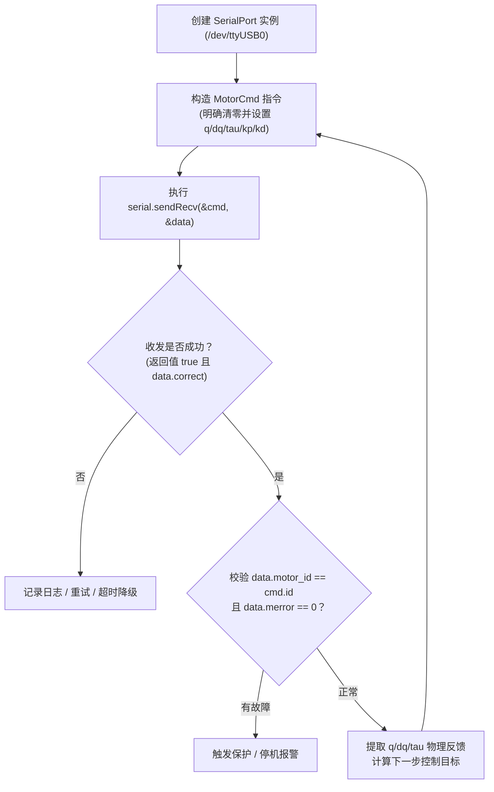

# Unitree 电机 C++ SDK 开发指南

本文档介绍宇树关节电机（Unitree Actuator SDK）在 **C++17 / Linux** 环境下的集成与开发方法。适用于 GO-M8010-6、A1、B1 等电机的控制与数据交互。

---

## 1. 快速上手：3 分钟跑通第一个电机程序

以下是一个结构完整、开箱即用的极简通信示例。该程序向 ID 为 0 的电机发送一条制动/锁定指令并读取实时反馈状态：

```cpp
#include <iostream>
#include <iomanip>
#include "serialPort/SerialPort.h"
#include "unitreeMotor/unitreeMotor.h"

int main() {
    try {
        // 1. 初始化串口（GO 电机标称波特率为 4.0 Mbps）
        SerialPort serial("/dev/ttyUSB0");

        // 2. 构造并显式初始化控制指令
        MotorCmd cmd;
        cmd.motorType = MotorType::GO_M8010_6;
        cmd.id        = 0;
        cmd.mode      = static_cast<unsigned short>(queryMotorMode(cmd.motorType, MotorMode::BRAKE));
        cmd.q         = 0.0f; // 目标位置 (rad)
        cmd.dq        = 0.0f; // 目标速度 (rad/s)
        cmd.tau       = 0.0f; // 前馈力矩 (N·m)
        cmd.kp        = 0.0f; // 位置刚度
        cmd.kd        = 0.0f; // 速度阻尼
        cmd.Res.L     = 0;

        // 3. 构造接收缓冲区
        MotorData data;
        data.motorType = cmd.motorType;
        data.correct   = false;

        // 4. 发送并同步接收反馈
        if (!serial.sendRecv(&cmd, &data) || !data.correct) {
            std::cerr << "通信失败或 CRC 校验未通过！\n";
            return 1;
        }

        // 5. 校验反馈 ID 与故障码
        if (data.motor_id != cmd.id) {
            std::cerr << "电机 ID 不匹配！预期: " << cmd.id << ", 收到: " << (int)data.motor_id << '\n';
            return 1;
        }
        if (data.merror != 0) {
            std::cerr << "电机发生故障，错误码: " << data.merror << '\n';
            return 1;
        }

        // 6. 解析并打印物理状态（转子量转为输出轴物理量）
        float gearRatio = queryGearRatio(cmd.motorType); // GO 电机为 6.33
        std::cout << "===== 电机 [ID: " << (int)data.motor_id << "] 状态 =====\n"
                  << "输出轴角度: " << data.q / gearRatio << " rad\n"
                  << "输出轴转速: " << data.dq / gearRatio << " rad/s\n"
                  << "转子力矩:   " << data.tau << " N·m\n"
                  << "输出驱动力: " << data.tau * gearRatio << " N·m\n"
                  << "电机温度:   " << data.temp << " ℃\n";

        return 0;
    } catch (const IOException& e) {
        std::cerr << "串口通信异常: " << e.what() << " (errno=" << e.getErrorNumber() << ")\n";
        return 1;
    } catch (const std::exception& e) {
        std::cerr << "运行错误: " << e.what() << '\n';
        return 1;
    }
}
```

### 快速单行编译命令 (x86_64)

```bash
g++ -std=c++17 main.cpp \
  -Ilib/unitree_actuator_sdk/include \
  -Llib/unitree_actuator_sdk/lib \
  -lUnitreeMotorSDK_Linux64 \
  -Wl,-rpath,'$ORIGIN/lib/unitree_actuator_sdk/lib' \
  -o motor_demo
```

---

## 2. 工程接入与 CMakeLists.txt 模板

SDK 位于项目的 `lib/unitree_actuator_sdk/` 目录下，包含完整的 C++ 头文件与 x86_64 / ARM64 预编译动态库。

### 推荐的 CMakeLists.txt 配置
可在项目中创建如下 `CMakeLists.txt`，自动根据编译平台识别架构并链接对应的 SDK 库：

```cmake
cmake_minimum_required(VERSION 3.16)
project(motor_control_app LANGUAGES CXX)

set(CMAKE_CXX_STANDARD 17)
set(CMAKE_CXX_STANDARD_REQUIRED ON)

# 定位 SDK 根路径
set(UNITREE_SDK_DIR "${CMAKE_CURRENT_SOURCE_DIR}/lib/unitree_actuator_sdk")

# 平台架构自动匹配
if(CMAKE_SYSTEM_PROCESSOR MATCHES "^(aarch64|arm64|ARM64)$")
    set(SDK_LIB_NAME "UnitreeMotorSDK_Arm64")
elseif(CMAKE_SYSTEM_PROCESSOR MATCHES "^(x86_64|amd64|AMD64)$")
    set(SDK_LIB_NAME "UnitreeMotorSDK_Linux64")
else()
    message(FATAL_ERROR "不支持的 CPU 架构: ${CMAKE_SYSTEM_PROCESSOR}")
endif()

# 导入 SDK 动态库
add_library(unitree_sdk SHARED IMPORTED)
set_target_properties(unitree_sdk PROPERTIES
    IMPORTED_LOCATION "${UNITREE_SDK_DIR}/lib/lib${SDK_LIB_NAME}.so"
    INTERFACE_INCLUDE_DIRECTORIES "${UNITREE_SDK_DIR}/include"
)

# 添加应用可执行文件
add_executable(motor_demo main.cpp)
target_link_libraries(motor_demo PRIVATE unitree_sdk)

# 设置运行时库搜索路径 (RPATH)
set_target_properties(motor_demo PROPERTIES
    BUILD_RPATH "${UNITREE_SDK_DIR}/lib"
    INSTALL_RPATH "${UNITREE_SDK_DIR}/lib"
)
```

---

## 3. 核心控制流程与时序

控制电机的标准主循环流程如下：



> [!WARNING]
> **必防的未初始化陷阱**：
> SDK 中 `MotorCmd` 和 `MotorData` 的默认构造函数**是空函数**，不会把成员初始化为 0。即使写 `MotorCmd cmd{};`，某些编译器仍可能保留栈内存垃圾数据。发送前**务必显式为每一个物理量字段赋值**！

---

## 4. 核心数据结构与接口说明

### 4.1 控制命令 `MotorCmd`

所有物理量指令均作用于**电机转子侧**：

| 字段名 | 类型 | 单位 / 取值 | 说明 |
| :--- | :--- | :--- | :--- |
| `motorType` | `MotorType` | `GO_M8010_6` / `A1` / `B1` | 电机类型，必须与硬件一致 |
| `id` | `unsigned short` | 0 ~ 14（15 为广播 ID） | 目标电机硬件 ID |
| `mode` | `unsigned short` | 通过 `queryMotorMode()` 查询 | 协议工作模式编号 |
| `q` | `float` | **rad (转子侧)** | 期望转子角度 |
| `dq` | `float` | **rad/s (转子侧)** | 期望转子角速度 |
| `tau` | `float` | **N·m (转子侧)** | 前馈转子力矩 |
| `kp` | `float` | 物理刚度（转子侧） | 位置跟踪刚度系数 |
| `kd` | `float` | 物理阻尼（转子侧） | 速度阻尼系数 |
| `hex_len` | `int` | 字节数 | 打包后长度，高层 `sendRecv` 自动填充 |

#### 常用控制模式配置组合：

```cpp
// 1. 切换到 FOC 闭环控制模式
cmd.mode = static_cast<unsigned short>(queryMotorMode(cmd.motorType, MotorMode::FOC));

// A. 纯前馈力矩控制模式
cmd.tau = 0.5f; cmd.q = 0.0f; cmd.dq = 0.0f; cmd.kp = 0.0f; cmd.kd = 0.0f;

// B. 位置伺服跟踪模式 (PD)
cmd.q = target_q_rotor; cmd.dq = 0.0f; cmd.kp = 5.0f; cmd.kd = 0.2f; cmd.tau = 0.0f;

// C. 纯阻尼柔顺模式 (外力手扳顺滑拖动)
cmd.kp = 0.0f; cmd.kd = 0.3f; cmd.tau = 0.0f; cmd.q = 0.0f; cmd.dq = 0.0f;
```

---

### 4.2 反馈数据 `MotorData`

| 字段名 | 类型 | 单位 | 说明 |
| :--- | :--- | :--- | :--- |
| `motor_id` | `unsigned char` | - | 反馈电机的硬件 ID |
| `mode` | `unsigned char` | - | 电机当前实际运行模式 |
| `q` | `float` | **rad (转子侧)** | 实时转子角位置 |
| `dq` | `float` | **rad/s (转子侧)** | 实时转子角速度 |
| `tau` | `float` | **N·m (转子侧)** | 实时电机输出转子力矩 |
| `temp` | `int` | ℃ | 驱动板/电机温度 |
| `merror` | `int` | 故障位 | 电机错误码（0 表示正常） |
| `correct` | `bool` | - | **本次通信数据 CRC 校验是否正确** |

#### GO-M8010-6 电机故障码表 (`merror`)：
* `0`：正常（无故障）
* `1`：过热保护（Over-temperature）
* `2`：过流保护（Over-current）
* `3`：过压保护（Over-voltage）
* `4`：编码器故障（Encoder fault）

---

### 4.3 电机型号与查询辅助函数

SDK 提供了型号参数查询接口，避免硬编码：

```cpp
// 1. 查询电机减速比
float gearRatio = queryGearRatio(MotorType::GO_M8010_6); // 返回 6.33

// 2. 查询工作模式编号
// 支持模式：MotorMode::BRAKE (制动), MotorMode::FOC (伺服), MotorMode::CALIBRATE (校准)
int focMode = queryMotorMode(MotorType::GO_M8010_6, MotorMode::FOC); // 返回 1
```

---

## 5. 物理量换算规则 (转子侧 $\leftrightarrow$ 输出轴侧)

算法规划在关节输出轴侧，驱动通信在转子侧。设电机减速比为 $N$（GO 电机 $N = 6.33$）：

### 5.1 运动与力矩换算
$$q_{rotor} = N \cdot q_{output}, \qquad \dot{q}_{rotor} = N \cdot \dot{q}_{output}, \qquad \tau_{rotor} = \frac{\tau_{output}}{N}$$

### 5.2 PD 增益换算
增益按减速比**平方**折算：
$$K_{p,rotor} = \frac{K_{p,output}}{N^2}, \qquad K_{d,rotor} = \frac{K_{d,output}}{N^2}$$

```cpp
// 示例：将输出轴规划的控制指令转换为 SDK 命令
const float N = queryGearRatio(cmd.motorType);

cmd.q   = q_output * N;
cmd.dq  = dq_output * N;
cmd.tau = tau_output / N;
cmd.kp  = kp_output / (N * N);
cmd.kd  = kd_output / (N * N);
```

> [!NOTE]
> 宇树早期的 A1 / B1 电机在协议层还额外除了 `26.07` 或乘了 `100`；**GO-M8010-6 电机不需要任何额外系数**，直接套用上述物理折算公式即可。

---

## 6. 串口通信类 `SerialPort` 使用指南

### 6.1 常用构造与参数
```cpp
SerialPort(
    const std::string& portName, // 串口设备名，如 "/dev/ttyUSB0"
    size_t recvLength = 16,      // 接收长度（GO 电机反馈包固定为 16 字节）
    uint32_t baudrate = 4000000  // 波特率：GO 电机默认为 4,000,000 (4 Mbps)
);
```

### 6.2 单电机收发 (推荐方式)
```cpp
bool ok = serial.sendRecv(&cmd, &data);
if (ok && data.correct && data.motor_id == cmd.id) {
    // 数据有效且安全，继续执行控制
}
```

### 6.3 多电机向量轮询收发
若总线上挂有多台电机，可使用 `std::vector` 批量接口：

```cpp
std::vector<MotorCmd> commands(2);
std::vector<MotorData> feedbacks(2);

// 分别配置每台电机指令...
commands[0].id = 0; commands[1].id = 1;

// 批量串行收发（若全部成功返回 true）
bool all_ok = serial.sendRecv(commands, feedbacks);
```

---

## 7. 实机部署与调试避坑指南

1. **Linux 串口访问权限**：
   若运行时报 `Permission denied`，可将当前用户加入 `dialout` 组，或配置 udev 规则：
   ```bash
   sudo usermod -aG dialout $USER
   ```
   注销并重新登录后生效。

2. **通信超时与控制周期匹配**：
   * GO 电机采用 4 Mbps 高速半双工 RS-485；
   * 每台电机一发一收耗时约 80~100 $\mu\text{s}$；
   * 如果在一条总线上挂 4 台电机，轮询一轮耗时约 0.4 ms，建议控制循环周期设为 **1 ms (1000 Hz)**，为串口调度留出稳定余量。

3. **线程安全性**：
   `SerialPort` 实例**不是线程安全的**。严禁在多个线程中对同一个 `SerialPort` 对象并发调用 `sendRecv`。建议每个独立的串口设备由一个专用的通信控制线程独占持有。
